<div align="center">


# DC_Recomp

**A native Windows port of *Dark Cloud* (NTSC-U, `SCUS-97111`), made by statically recompiling the game's PlayStation 2 code to C++ on BozoEngine.**<br>
The game's own MIPS R5900 code runs as a PC program, drawing and playing sound through native PC services.
BozoEngine replaces the PS2Recomp fork completely; there is no emulation fallback. A Linux build is planned.


</div>

> [!IMPORTANT]
> No game files are included: no ELF, overlays, IRX modules, data archives, or code generated from them.
> You need **your own copy** of the North American release, PS2 ID **`SCUS-97111`** (disc version 1.02). The port is
> built against that disc's files:
>
> | File | SHA-1 |
> |---|---|
> | `SCUS_971.11` | `d9965d6908a334a5dfc982f3384428ad42048d54` |
> | `TITLE.BIN` | `8da27dd6a4f8d2090216b17d5d64a0c142cfd6d5` |
> | `DUN.BIN` | `ab7e56a4eeb69e178638088de6e57857d48f1d98` |

## Status

**Bring-up, not playable yet.** The BozoEngine build boots, shows the title screen and its attract sequence, loads
an existing memory-card save into Norune, and draws Toan, the village and its HUD. Movement, pause/unpause and the
main game menu have been checked, with native music and effects. A 4,100-frame window run held approximately 60
updates and presents per second on the development PC.

The earlier build also reached New game's opening and Georama. Those paths, dungeons, combat and a complete
playthrough still need checking on BozoEngine. The migration restores the tested Norune baseline; it does not
clear the earlier rendering defects.

| Milestone | |
|---|:---:|
| Function map from the ELF's own symbol table (main program and both overlays, no Ghidra) | ✅ |
| Recompile the main ELF and link it with BozoEngine; remove the PS2Recomp dependency | ✅ |
| Code overlays `TITLE.BIN` and `DUN.BIN` (one load slot, selected by resident identity) | ✅ |
| Boot: native SDK services, reads from the owner's disc, memory card detected | ✅ |
| Title screen, attract sequence and native 3D rendering | ✅ |
| Norune: load an existing save, Toan/HUD, movement, pause and main menu | ✅ |
| Native music and effects | ✅ |
| New game: opening scenes and Georama rechecked on BozoEngine | 🔧 |
| First dungeon (Divine Beast Cave), combat and full story | ⏳ |
| Memory card: existing save loading; game-side saving rechecked on BozoEngine | 🔧 |
| Linux build | ⏳ |
| Widescreen, higher internal resolution | ⏳ |

**Native port.** The game's draws are built straight from its own models, textures, camera, lights and drawing
routines. BozoEngine supplies the native SDK services, renderer and mixer. There is no GS memory, GIF packet
renderer, VIF/VU1 execution, IOP interpreter, SPU2/SIO2 device backend or emulation fallback.

| Layer | |
|---|:---:|
| Main EE functions and both overlays statically recompiled to C++ | ✅ |
| Five sound libraries relocated and recompiled offline, without a firmware bootstrap | ✅ |
| Pad and memory-card libraries answered through native SDK services | ✅ |
| Compiled sound drivers and native libsd/mixer; no SPU2 emulator | ✅ |
| Native frame loop on the PC's clock (60 fps) | ✅ |
| OpenGL renderer on the GPU; no paraLLEl-GS or GS renderer | ✅ |
| 3D models, shadows and cloth drawn from the game's data; VU1 runs no microcode | ✅ |
| Disc textures converted offline; no console texture layout decoded during play | ✅ |
| Menus, text, HUD, frame copies and depth of field drawn natively | 🔧 |
| Remaining screen-space sprites, particles and other effects translated | 🔧 |

✅ works · 🔧 in progress · ⏳ not reached yet

Native thread/timer/file contracts, logical addresses and transfer-completion acknowledgements remain as SDK
compatibility services. Unknown native calls, unsupported module code and device-address accesses fail explicitly.
Movies use FFmpeg; configuring this port without the native decoder fails.

The native graphics boundary retains no GS register bank or transfer history. Environment submissions and graphics
completion never inspect GIF packets. Visibility queries read the native GPU depth cache directly from the game's
query coordinates. Some recompiled routines and SDK output builders still construct unused console-format buffers;
the renderer does not consume them. Material and texture formats in game structures are translated to native draws.
The model draw, material setter, and three environment/blend setters now produce native output only. Packet-only
TEST/ZBUF setters return without reading their arguments or constructing console output. BozoEngine
answers the graphics DMA send/sync APIs directly, including completion handlers, without packet reads or busy polling.
The tested native route now reaches **zero device-register accesses**: vblank fields use the native frame counter,
display submission and DMA configuration use SDK services, and console CPU/free-time diagnostics and channel tag-bit
updates are retired during guarded code generation. Native mode rejects access to retired graphics registers.
See [the cleanup and validation notes](docs/BOZO_MIGRATION.md#native-graphics-cleanup) for the remaining compatibility work.

Static models now retain their captured geometry after loading buffers are reused. This fixes a source-lifetime
failure that could remove Norune's terrain; the controlled before/after reproduction is recorded in the migration notes.

Known defects, including issues carried over from the earlier build:

- the sky band above Norune's hills is bluer than on a PS2;
- a green wedge sometimes shows in Norune;
- a Georama menu picture ("stayframe") sometimes fails to decode;
- the characters' shadow plane still needs tracing through the original shading logic;
- some frame-copy surfaces, effects and in-game menus remain unchecked.

[docs/BOZO_MIGRATION.md](docs/BOZO_MIGRATION.md) records the current migration and validation.
[docs/RECOMP_NOTES.md](docs/RECOMP_NOTES.md) retains the port's bring-up history, fixes and open investigations.

## Screenshots


Historical bring-up captures from before the native renderer and BozoEngine migration. They show the earlier
progress and are not evidence of the current build; current validation is in
[docs/BOZO_MIGRATION.md](docs/BOZO_MIGRATION.md).

| | | |
|---|---|---|
| 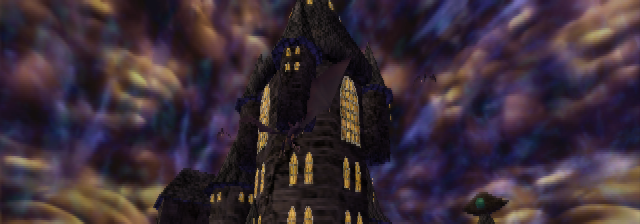 | 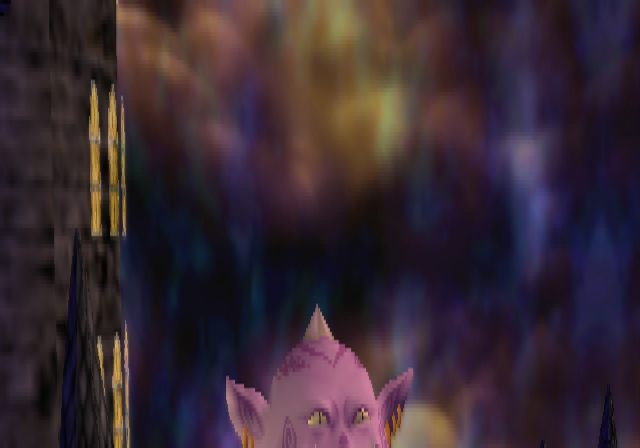 | 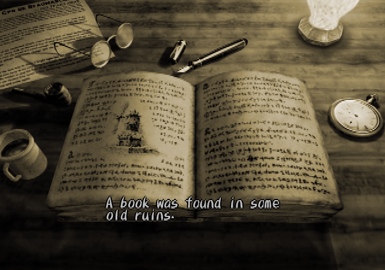 |
|  | 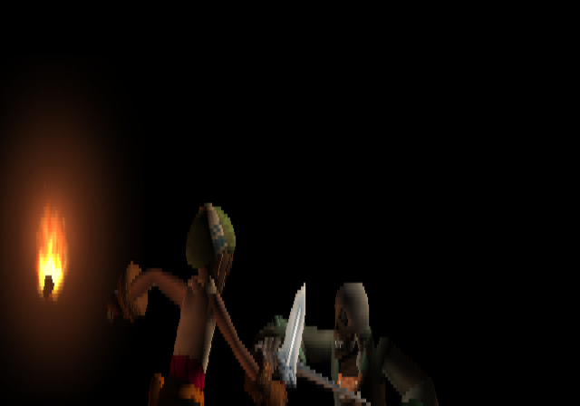 | 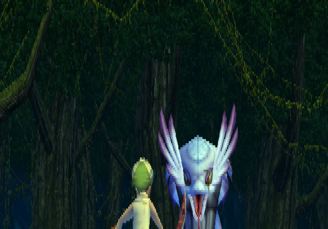 |
| 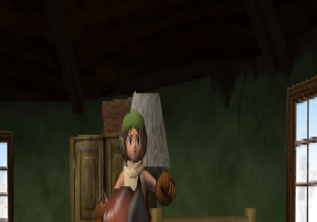 | 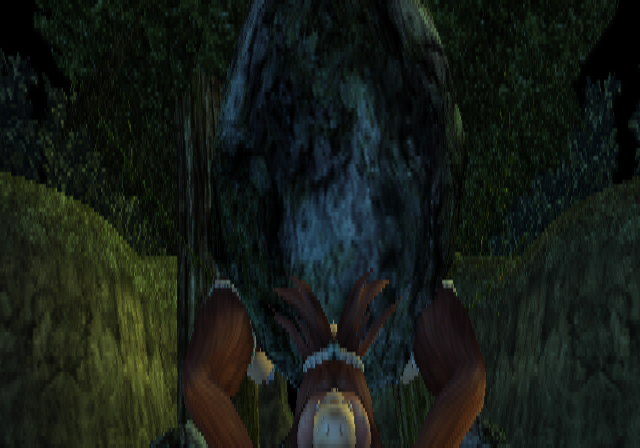 | 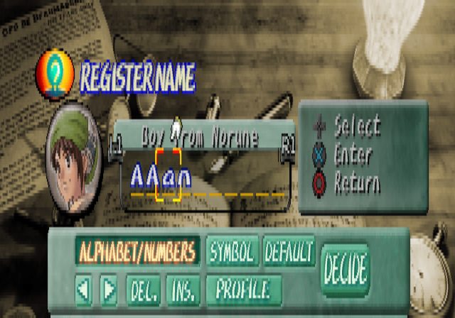 |
| 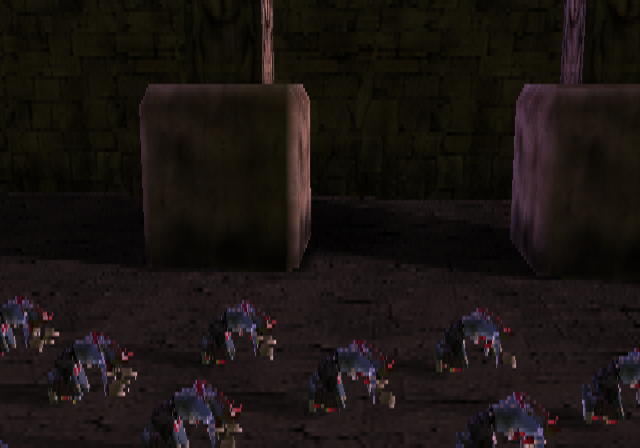 | 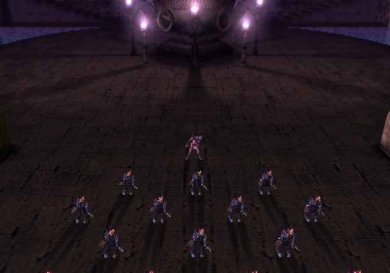 | 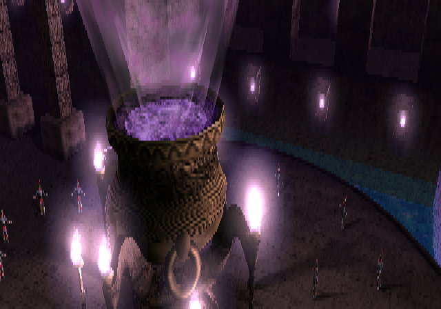 |
| 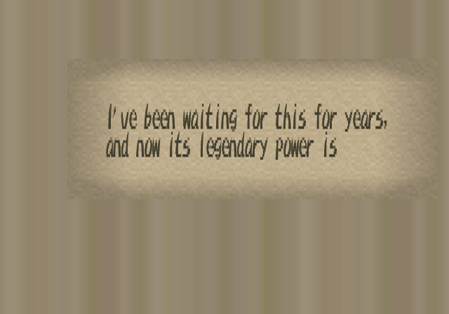 | 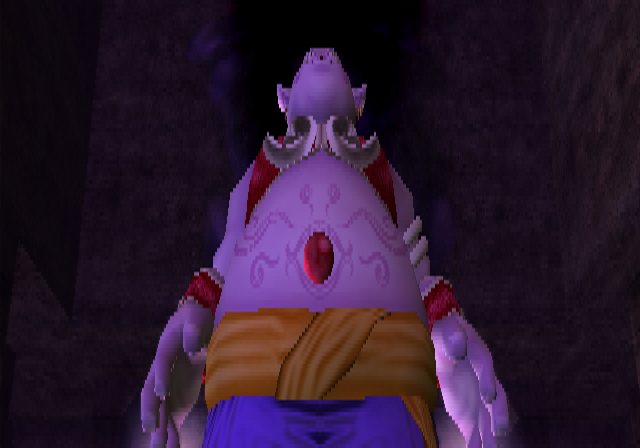 | 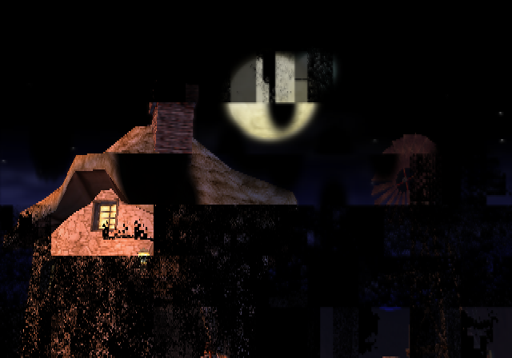 |
| 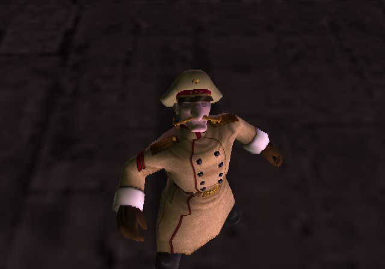 | 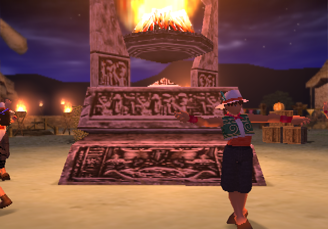 | 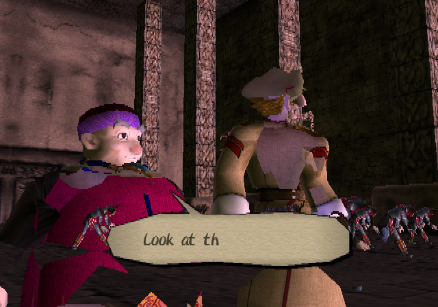 |

## How it works

```
disc files (game/) ──► tools/dc_bozo_prepare.py ──► resident ELF + TITLE/DUN overlay ELFs
                                           │
                        BozoEngine's bozo-recomp ──► native C++ in build/bozo/dc_gen/
   five sound IRX ──► offline relocation + strict native translation ──► build/bozo/dc_audio_gen/
   disc textures ──► tools/dc_texconv.py ──► build/bozo/textures/dc_textures.bin
                                           │
                 CMakeLists.txt ──► BozoEngine + generated code + DC's own adapters
                                           │
   dc_native.cpp: models, lighting, shadows, cloth, menus and HUD ──► native OpenGL renderer ─┐
   dc_audio.cpp: compiled drivers + native libsd ──► native mixer                           ├─► dc.exe
   dc_port.cpp: native frame boundary; SDK files, cards and pads ──► native host services ───┘
```

- The retail executable keeps its CodeWarrior symbols. `tools/symtab_map.py` and the retained function maps define
  the resident code and overlays; no Ghidra pass is needed. The offline preparation checks all three disc hashes.
- `TITLE.BIN` and `DUN.BIN` are `MWo3` modules sharing `0x01DABD00`. Each has its own generated symbols and function
  table; native dispatch checks the resident header before selecting it, including resume entries.
- `runtime/dc_native.cpp` translates the game's MDT models, RenderInfo camera/lights, textures and drawing calls
  into native draws. It does not read console graphics packets or run VU1 microcode.
- `LIBSD`, `SDRDRV`, `MODMIDI`, `MODHSYN` and `EZMIDI` are relocated and compiled offline. Their SDK calls use
  reusable native services; libsd uses the native mixer. Pad/card modules are replaced at their SDK interfaces.
- The top-level build generates code and converts textures automatically, then links the windowed `dc` and
  `dc-headless` runners. Game-derived output stays in the ignored build directory.

[BozoEngine](https://github.com/TheBozos/BozoEngine) is the sole engine submodule. Game-specific addresses, formats,
hook choices and module layouts stay in DC_Recomp; engine changes must be generic and reusable by other recompiles.

## Requirements

- Windows 10/11 with [MSYS2](https://www.msys2.org/) (UCRT64, see below); Linux is not qualified yet
- CMake 3.21+, Ninja, GCC with C++20 support; development builds currently use MSYS2 GCC
- FFmpeg development libraries (`libavcodec`, `libavutil`) through `pkg-config`, or a compatible build supplied with `BOZO_FFMPEG_ROOT`
- `bsdtar` (libarchive) to extract the disc, Python 3; the offline texture converter uses only the standard library
- OpenGL 3.3 for the window; SDL3 and ImGui are fetched at pinned revisions by BozoEngine
- Your own copy of `SCUS-97111` (check the hashes above)

## Build and run

```bash
git clone --recurse-submodules https://github.com/TheBozos/DC_Recomp.git
cd DC_Recomp
scripts/extract_iso.sh "/path/to/Dark Cloud (USA).iso"   # disc files -> game/
scripts/build_runtime.sh Release \
    -DDC_ISO="D:/path/to/Dark Cloud (USA).iso"           # native code, sound and textures -> build/bozo/
scripts/run.sh                                         # build/bozo/dc.exe
```

With a separate FFmpeg build, add `-DBOZO_FFMPEG_ROOT="D:/path/to/ffmpeg"` (containing `include/` and `lib/`) to the
build command. `scripts/recomp.sh`, `scripts/overlays.sh` and `scripts/iop_recomp.sh` are optional generation
shortcuts; the full build already includes those stages. `DC_WINDOW=OFF` builds only `dc-headless`.

The binaries retain the configured data paths. `--elf` and `--iso` override the disc locations; `DC_TEXTURES` selects
a relocated native texture pack. The window uses BozoEngine's keyboard/gamepad input and per-user card directory.
Existing `game/mc0` saves migrate through its application-data service. `--card-dir` selects an isolated directory
containing `mc0`; headless runs use an in-memory card unless a directory is supplied.

### Windows

Run the scripts in an MSYS2 **UCRT64** shell (MSVC is not supported for this port):

```bash
pacman -S --needed mingw-w64-ucrt-x86_64-{gcc,cmake,ninja,pkgconf,ffmpeg,libarchive,python} git
```

The validated static build imports only Windows system/UCRT DLLs. For a build using dynamic dependencies,
`scripts/stage_dlls.sh` stages its MSYS2 DLLs next to `dc.exe` for launching outside the shell.

### Checks and captures

```bash
cmake -S . -B build/bozo -DDC_ENGINE_TESTS=ON
cmake --build build/bozo --parallel 6
ctest --test-dir build/bozo --output-on-failure
build/bozo/dc-headless.exe --frames 1400 --wav build/boot.wav
scripts/boot_test.sh title 30 5
```

The local suites cover instructions, runtime, ELF decoding, native libraries/kernel/audio, strict compiled-library
execution and GPU render-target readback. GPU checks require OpenGL 3.3. `scripts/engine_tests.sh` runs the standalone
headless engine suites; `scripts/fork_tests.sh` remains an alias for existing contributors. CI checks the pinned
engine with game-free fixtures and validates the offline tools/scripts; retail gameplay checks use the owner's disc.

`--pad-script <file>` accepts entries such as `1200:START/6,1500:CROSS/6`; `--live-pad <file>` reloads changed script
text starting at the current game frame. `--frames 0` runs until the window closes (the window's default).
`--capture-dir`, `--capture-frame` and `--wav` provide native captures. There is no fallback switch.
`--profile-io` prints remaining register accesses by guest PC/address after a bounded run; the validated Norune route
prints a zero total. The guarded adaptations in `recomp/dc_native.patches` are applied automatically by CMake.
MDT creation/remaking, shadow-model and cloth preparation now retain native asset bookkeeping without serializing
console buffers. Their old arena extents remain for caller compatibility; 1,064 synthetic cases check those sizes
against the original compiled builders. See [migration validation](docs/BOZO_MIGRATION.md) for scope and limitations.
Texture-group reload also uses native bookkeeping, and texture-load wrappers retain asset parsing while skipping
upload packet work; 666 manager-state and 60 texture-record comparisons cover those boundaries.
Fixed and fixed-Z texture insertion uses native records and bindings without image/cache/DMA builders; another
224 comparisons check the original allocation and metadata contracts. The latest 5,800-frame headless and windowed
routes also report zero GIF SDK submissions.
The model packet overload and GIF envelope/TEXA wrappers also skip obsolete output. Window setters retain the
logical rectangle directly. Visibility reduces native depth tiles into query results without an SDK readback
packet or scratch tile; 144 original-loop comparisons check depth patterns, boundaries and arena bookkeeping.
Water and running-effect wrappers also bypass their packet-only state envelopes while keeping native draws and
game bookkeeping. Another 96 water and 384 effect comparisons check their retained callbacks, data and ABI.
Frame-end completion also runs without packet closing or packet-header reads; the native SDK completion and its
masked callback queue remain intact, checked in 32 reference/adapted cases.

## Disc facts


| | |
|---|---|
| Boot ELF | `SCUS_971.11`, entry `0x100008`, one segment at `0x100000` (1.6 MB of code and data, BSS up to `0x1DABD00`), symbols kept |
| Code | `0x100000-0x2452B8` (EE code), `0x245300-0x24FB00` (VU microcode), `0x29FE80-0x2A1010` (static initializers) |
| Overlays | `TITLE.BIN` (177 functions) and `DUN.BIN` (62 functions), CodeWarrior `MWo3`, both at `0x01DABD00` |
| Video mode | NTSC |
| IOP modules | `MODULES/*.IRX`: SIO2MAN, PADMAN, MCMAN, MCSERV, LIBSD, SDRDRV, MODMIDI, MODHSYN, EZMIDI (and the unused network stack: INET, AN986, LIBNET, NETCNF, MSIFRPC, USBD) |
| IOP image | `MODULES/IOPRP211.IMG` |
| Data | `DATA.DAT` (1.7 GB archive) with its indexes `DATA.HED` and `DATA.HD2` |

## Sharing the machine with other ports

The team's native ports share a local benchmark lock, now provided by BozoEngine's `tools/bench_lock.sh`. Its
protocol remains compatible with the other ports: a game run takes one slot; a build or timed measurement takes
the bench alone.

```bash
scripts/bench_run.sh 5 "boot test" scripts/run.sh
scripts/bench_run.sh --alone 20 "runner build" scripts/build_runtime.sh
```

## Repository layout

| Path | Contents |
|---|---|
| `BozoEngine/` | Native recompiler/runtime submodule (MIT) |
| `recomp/` | Retained function maps and historical recompiler declarations |
| `runtime/` | DC's runner, native frame/render/audio adapters, and Windows icon/version resources |
| `scripts/` | Extract, generate, build, run, capture, engine tests and shared benchmark lock |
| `tools/` | Offline ELF/overlay preparation, native sound generation, texture conversion and analysis helpers |
| `docs/` | Migration/bring-up notes, historical screenshots and the team's DC branding |
| `.github/workflows/native.yml` | Game-free checks for the pinned native engine and port tools |

Everything derived from the game (disc folders/images, generated C++, build output and validation captures) stays
local and git-ignored. No game executable, disc data or generated game code is distributed. The screenshots above
are the repository's retained historical documentation.

## Credits

- **The Bozos**: boubou666 and Arzaroth, who make this port and BozoEngine
  ([RecompWatcher](https://thebozos.github.io/RecompWatcher/) shows our projects).
- [BozoEngine](https://github.com/TheBozos/BozoEngine), The Bozos' MIT recompiler and native runtime, now the port's only engine.
- [PS2Recomp](https://github.com/ran-j/PS2Recomp) by ran-j and contributors (GPL), on which the earlier port was built;
  it remains credited in the project's history.
- The team's other recompilations, including *Twisted Metal: Black*, *The Lord of the Rings: The Third Age*,
  *Jade Cocoon 2*, *Valkyrie Profile 2: Silmeria* and *Drakengard*, which share native development work.
- *Dark Cloud* © Sony Computer Entertainment, developed by Level-5. This is an unofficial fan project, not affiliated
  with or endorsed by them.
